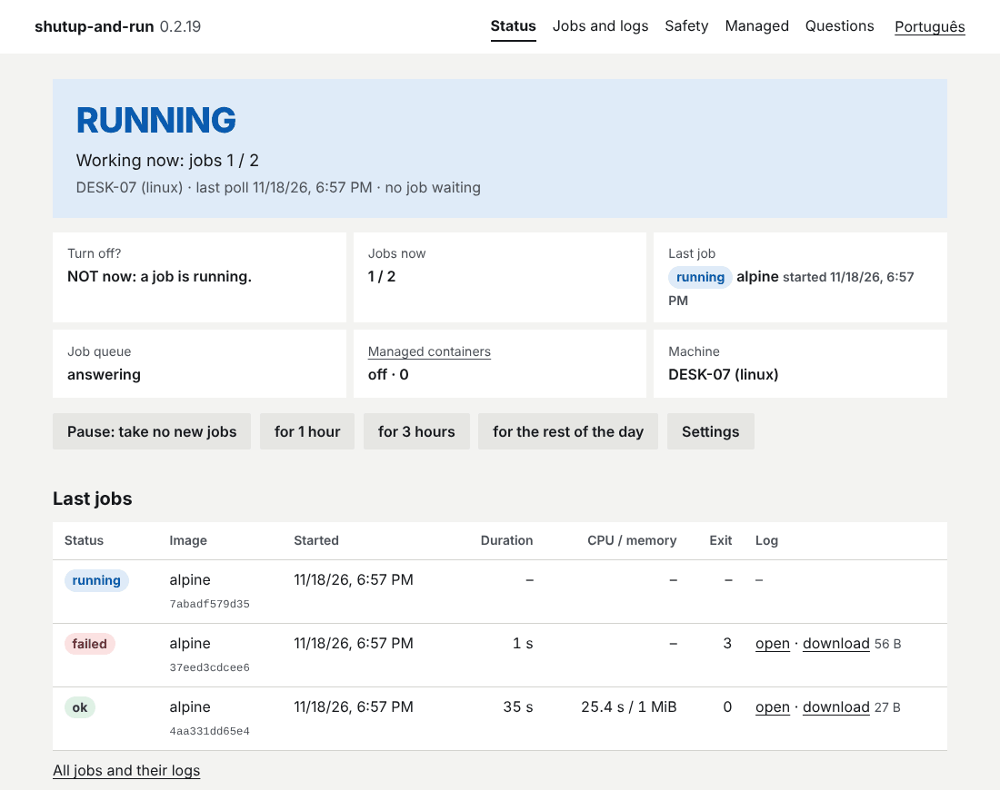
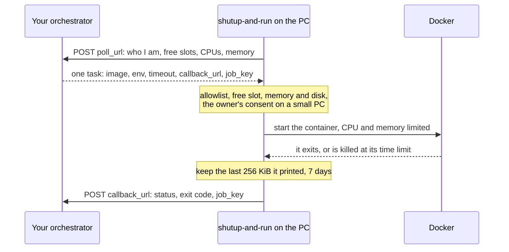
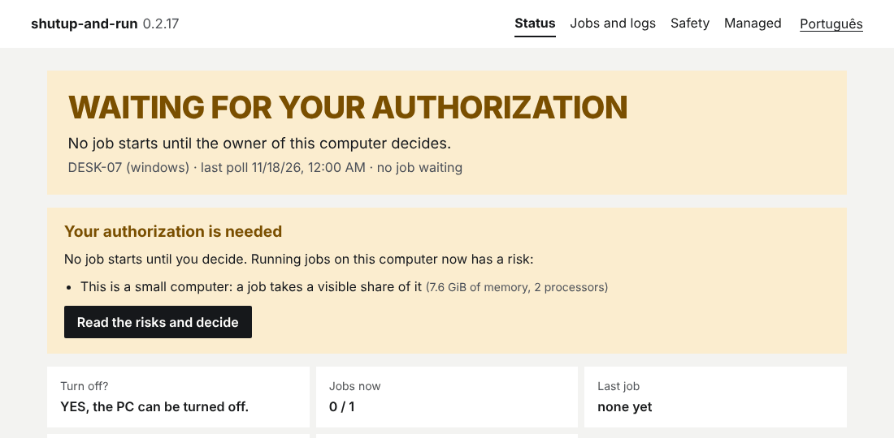
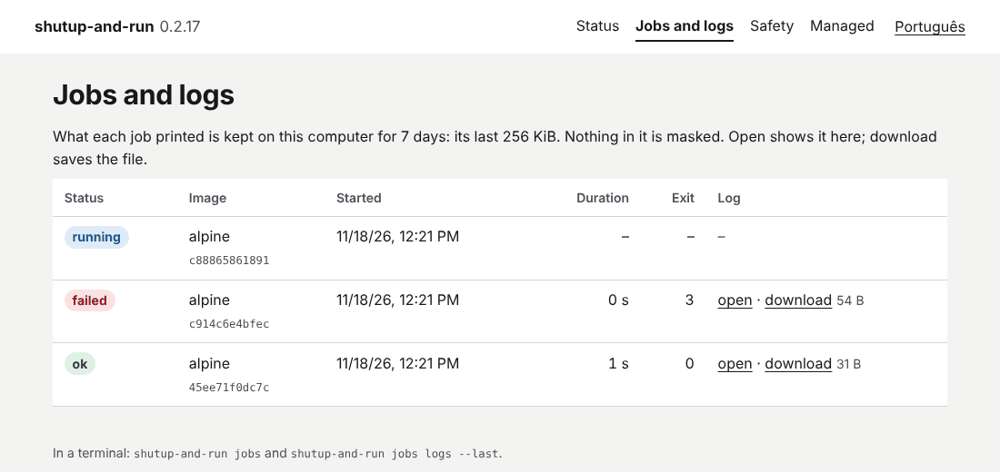
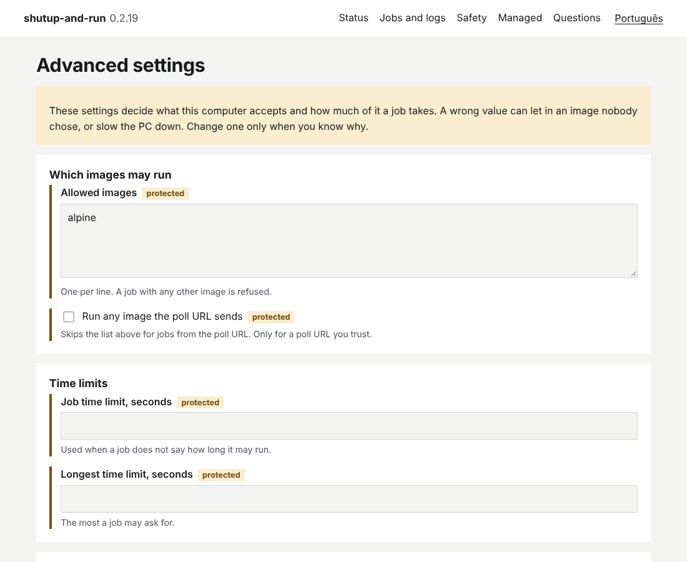
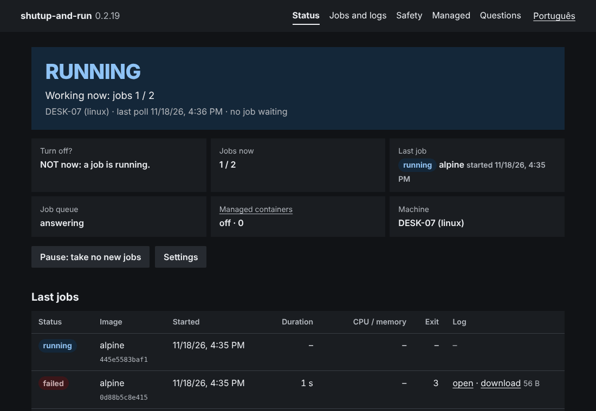
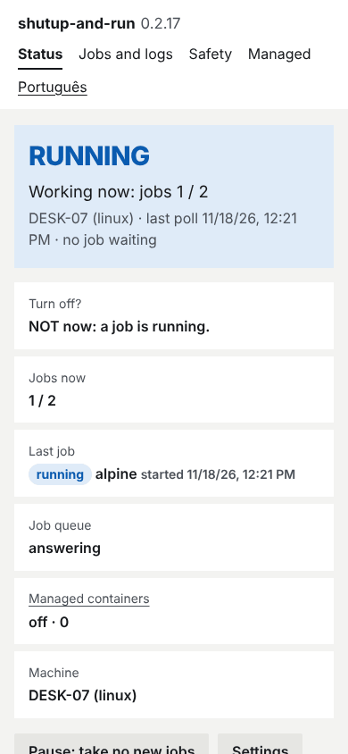

# shutup-and-run

[Português](README.pt-BR.md)

[](https://github.com/nailtongomes/shutup-and-run/actions/workflows/ci.yml)
[](https://github.com/nailtongomes/shutup-and-run/releases/latest)

**Run your automations' containers on the idle PCs your customers already own, without getting in the way of the person using them.**

A small, self-hosted Docker job runner, in Rust. An orchestrator you already use (n8n, Kestra, your own API) hands it a task; it starts that container on the customer's Windows 11 or Linux machine, keeps it inside limits, stops it at its time limit, and calls you back with how it ended.



- **Made for a shared PC.** Someone may be working on the machine while a job runs, and their work comes first: a CPU and a memory limit on every container, one job at a time by default, no new job while memory or disk is short, and on a small PC nothing runs until its owner says yes.
- **Nothing to open on the customer's PC.** A Windows worker asks a URL of yours for work. No inbound port, no Docker Desktop, no administrator after WSL2 is enabled, and no window.
- **Made to be run by an AI agent.** Every command is non-interactive, prints JSON and has a fixed exit code. The config is one file that is never edited by hand. A doctor names each problem with the command that fixes it.
- **Small.** One static binary, a SQLite history, a local page on `127.0.0.1` for the person at the PC, and what each job printed kept on the machine for 7 days.

**Questions?** The [FAQ](docs/FAQ.md) answers what to expect: a slow PC, a battery, a shutdown, a job that did not start.

**Contents:** [How it works](#how-it-works) · [Quick start](#quick-start) · [The local page](#the-local-page) · [Protecting the PC](#protecting-the-pc) · [Managed containers](#managed-containers) · [For an AI agent](#for-an-ai-agent) · [The API](#push-pull-and-the-api) · [Security](#security) · [Limits](#limits)

## What it is, and is not

| It does | It does not |
| --- | --- |
| Start an allowlisted container image with the env, command, timeout and limits a task names | Queue, retry or chain tasks. Your orchestrator does that |
| Or, in [managed mode](#managed-containers), run containers defined on the machine: once, on an interval, or always | Replace Compose, Kubernetes or a workflow engine. A managed container is one image and when to run it |
| Take work two ways: **push** (`POST /v1/jobs`) and **pull** (the worker polls a URL of yours) | Coordinate machines. Each worker knows only itself |
| Cap concurrency (`max_slots`), time (`timeout_secs`, then SIGKILL), CPU and memory per job | Sandbox the job. A container has Docker's default privileges and network |
| Refuse work when full, draining, or short of memory or disk | Mount host folders, publish ports, or run privileged. There are no such fields |
| Keep a job history in SQLite and call a webhook when a job ends | Return a job's output to you. A job reports an exit code and its data is sent by the container; what it printed stays on the machine for 7 days |
| Show a local page with status and settings, on the machine only | Offer a dashboard, or any page reachable from the network |

## How it works

```text
            your orchestrator (n8n, Kestra, your own API)
            ---------------------------------------------
              keeps the queue, picks the machine, gets the callback
                 |                                   ^         ^
   push: POST /v1/jobs                  pull: POST poll_url    | callback_url
   202 accepted / 429 full / 503        "any work for me?"     | when a job ends
                 v                                   |         |
   Linux server (yours, trusted)        Windows 11 PC (a customer's, shared)
   -----------------------------        ------------------------------------
   shutup-and-run.service               shutup-and-run.exe: supervisor, logon task
   HTTPS :8787, bearer token              WSL2 distribution "shutup-and-run"
   Docker Engine                            the same Linux binary, in pull mode
                                            Docker Engine (no Docker Desktop)
                                            local page on 127.0.0.1:8787
```

- **Linux** runs the service under systemd. It usually takes pushes over HTTPS. It can also pull, for a machine behind NAT.
- **Windows 11** runs the same Linux binary inside a WSL2 distribution of its own, in pull mode only. No port is opened on the PC and nothing is pushed to it. The `.exe` is a supervisor: it installs the distribution, keeps the service running while the user is logged on, and never shows a window. Details: [docs/WINDOWS.md](docs/WINDOWS.md).
- **A job** is one container. `202` means the machine took it and holds a slot; the image is pulled afterwards. When it ends, by itself, at its timeout, or because it could not start, the result is POSTed to the task's `callback_url`, and sent again for up to an hour if nobody answers.
- **The contract** for an orchestrator, with JSON Schemas, is [docs/INTEGRATION-CONTRACT.md](docs/INTEGRATION-CONTRACT.md). A complete n8n example, with worker approval, is in [examples/n8n](examples/n8n/README.md).

The life of one task in pull mode, the Windows way:



In push mode the first two steps are one `POST /v1/jobs` from your orchestrator to the worker, answered `202`.

## Quick start

### Windows 11 PC, pull mode

WSL2 has to be enabled once, as administrator, followed by a reboot: `wsl --install --no-distribution`. Then, in PowerShell, as the user who stays logged on:

```powershell
irm https://raw.githubusercontent.com/nailtongomes/shutup-and-run/main/scripts/install.ps1 | iex
```

```powershell
shutup-and-run wsl install --poll-url "https://orchestrator.example/poll?user=ana"
```

The first line downloads the `.exe`, checks its SHA-256 and puts it on the user's `PATH` (open a new terminal if `shutup-and-run` is not found). The second takes a few minutes and ends with the doctor. It is safe to run again. Leave `--poll-url` out to install a machine idle and check it first.

```powershell
shutup-and-run doctor
```

The worker now polls your URL with a token of its own. Your orchestrator sees an unknown token and approves the machine or not: [enrollment](docs/WINDOWS.md#install). The person at the PC has a desktop shortcut to the local page, `http://127.0.0.1:8787/`.

### Linux server, push mode

Ubuntu with a public address:

```bash
curl -fsSL https://raw.githubusercontent.com/nailtongomes/shutup-and-run/main/scripts/install.sh | sudo SHUTUP_AND_RUN_ALLOWLIST=ghcr.io/you/worker bash
```

It installs Docker if needed, starts the service on port 8787 over HTTPS with a self-signed certificate, and prints the URL and the certificate fingerprint. Read the token, then send a job from anywhere:

```bash
sudo sed -n 's/^SHUTUP_AND_RUN_TOKEN=//p' /etc/shutup-and-run/env
```

```bash
curl -sk -X POST https://203.0.113.10:8787/v1/jobs -H "Authorization: Bearer $SAR_TOKEN" -H 'Content-Type: application/json' -d '{"image":"ghcr.io/you/worker","timeout_secs":600,"job_key":"hello-1","env":{"JOB_NAME":"hello"}}'
```

```bash
curl -sk -H "Authorization: Bearer $SAR_TOKEN" "https://203.0.113.10:8787/v1/jobs/PASTE_ID?logs=true"
```

`-k` skips certificate verification; pinning the fingerprint is in [docs/RECIPES.md](docs/RECIPES.md). Ready-made flows: [examples/kestra-dispatch.yml](examples/kestra-dispatch.yml), [examples/n8n-dispatch.json](examples/n8n-dispatch.json), and for pull [examples/kestra-poll.yml](examples/kestra-poll.yml), [examples/n8n-poll.json](examples/n8n-poll.json).

## First run without an orchestrator

Five commands, all non-interactive, all with `--json`. None changes the worker's config or its job history.

```
shutup-and-run version --json                # the build, platform, runtime (docker or wsl2), API version
shutup-and-run config check                  # preflight: config, Docker, storage, limits, allowlist, poll host
shutup-and-run demo                          # one container through the worker's own path
shutup-and-run job validate task.json        # would this machine accept this task? Nothing runs
shutup-and-run demo sign                     # a container signs a made-up PDF; the signature is verified
```

- **`demo`** starts `hello-world` (or `--image`) the way a task starts: the allowlist, the per-job limits and admission all apply. It checks that the container exited 0, that Docker really applied the CPU and memory limits, and that nothing is left. An image the machine may not run is a failure with the command that allows it, not something the demo works around.
- **`job validate`** runs the same check as `POST /v1/jobs` on a file with a task (`-` for stdin, `--poll` to check it as a polled task). Exit 3 with a code (`JOB_INVALID_JSON`, `JOB_INVALID_FIELD`, `JOB_IMAGE_NOT_ALLOWED`) when the API would answer `400` or `403`. It does not pull, take a slot or write history, and a valid task can still be refused later: slots, a pause, free memory and disk, and the image pull are checked only when it is sent.
- **`config check`** exits 3 when the config itself is invalid and 1 when something around it is wrong. A poll URL whose host does not answer in 8 seconds is a warning (`POLL_UNREACHABLE`), not an invalid config.
- **`demo sign`** needs the openssl program and the image `python:3.12-slim` on the allowlist. It uses a throwaway certificate unless `--configured`. The signed PDF is written to `--out` (default `shutup-and-run-demo-signed.pdf`).
- **`doctor --json`** gives every check a stable `code` beside `name`, `status`, `detail` and `hint`: `DOCKER_UNAVAILABLE`, `CONFIG_INVALID`, `SERVICE_NOT_RUNNING`, `POLL_NOT_APPROVED`, `LOW_MEMORY`, and `NAME_OK` for a check that passed. The list is in [docs/FOR-AGENTS.md](docs/FOR-AGENTS.md#diagnostic-codes).

## Protecting the PC

The customer's interactive work has priority over job throughput. On a shared PC these layers enforce that:

| Layer | `shared-pc` default | Set with |
| --- | --- | --- |
| The WSL2 VM (Windows only) | about 40% of the RAM, half the logical processors | `%UserProfile%\.wslconfig`, through `shutup-and-run wsl limits` |
| Each job | 1 CPU, 2 GiB of memory, no swap beyond it | `max_job_cpus`, `max_job_memory` |
| Jobs at once | 1 | `max_slots` |
| Starting a job | only with 2 GiB of memory and 5 GiB of disk free | `min_free_memory`, `min_free_disk` |
| Starting a job (Windows, optional) | only after the PC was not used for N seconds; off by default | `min_idle_secs` |
| Starting a job, when (optional) | only inside the hours the machine lends itself, like `mon-fri 19-07; sat,sun`; any time by default | `lend_hours` |
| Starting a job (Windows) | not on the battery below 60%, not while the person presents or has a program in full screen; on the battery above 60% jobs start and the page says so | not configurable |
| Starting a job, the computer's safety | never while memory, disk or processor are critical; on a small or busy computer, only after its owner authorized it | not configurable; the owner decides on the local page |

- The limits are enforced by Docker (`NanoCpus`, `Memory`, `MemorySwap`), on a pushed job and on a pulled one. A task that names no `cpu` or `memory` gets the machine's limit; one that names less gets what it asked; one that names more is refused with the limit in the answer.
- Outside `lend_hours`, on the battery below 60%, or while the person presents or has a program in full screen, a push is answered `503` `not lending now` and a pull worker does not ask for work. A job already running goes on in every case.
- While memory or disk is short, a push is answered `503` `insufficient resources` and a pull worker simply does not ask for work, so no task is claimed and then dropped. It resumes by itself. `status` shows `waiting_for`.
- Before every job the worker also judges the computer itself, on Windows the PC and not only the WSL2 VM: **healthy**, **warning** or **blocked**. Blocked (under 10% of memory or 2 GiB of disk, processors saturated, a reading that could not be taken, three jobs killed for memory in half an hour) starts nothing, answers a push with `503` `blocked for safety`, and clears by itself. A warning (under 8 GiB of memory or 2 processors or fewer, memory under 20%, processors busy) starts a job only after the owner of the computer read the risks and said yes, once, on the local page or with `shutup-and-run safety authorize` at a terminal; until then a push gets `503` `authorization required`. When the owner already agreed in the contract, whoever installs records that consent at the machine with `shutup-and-run wsl install --owner-consent` (or `shutup-and-run safety authorize --owner-consent`), and the PC is ready at once. No config key or API field says yes, and the yes never lifts a block. `shutup-and-run safety` shows the state; a job killed for memory is reported as such (`oom_killed`). The thresholds and what is not covered are in [docs/WINDOWS.md](docs/WINDOWS.md#sharing-the-pc).
- Where the service sees under 4 GiB (an 8 GiB PC gives WSL2 about 3.2 GiB), the two memory figures are half of what it sees. Not every PC can run a 2 GiB job.
- The `shared-pc` profile is the default on Windows, also for a worker installed before 0.2.6. On a Linux desktop: `shutup-and-run config set resource_profile shared-pc --apply`. A Linux server is unchanged unless you set it.
- `.wslconfig` belongs to the user and covers every WSL2 distribution. The install writes it only when it does not exist and the PC has no other distribution. An existing file is changed only by `shutup-and-run wsl limits --apply`, which keeps every other line and a backup. A change takes effect when WSL restarts; this program never runs `wsl --shutdown`.

```
shutup-and-run status --json          # "limits" in force, and "waiting_for"
shutup-and-run doctor                 # the "resources" line; on Windows also "wsl-limits"
shutup-and-run config set max_job_memory 1g --apply
shutup-and-run wsl limits             # Windows: the PC, the budget, what .wslconfig says
```

**This reduces the risk; it does not remove it.** Free memory is measured inside the WSL2 VM, which is not the same as free memory on the Windows host, and only at the moment a job starts. Disk and network use of a job are not limited. There is no monitoring daemon, and a running job is never stopped to make room or because the person came back. With a job running, Windows asks before it shuts down or signs out; "shut down anyway" and a power cut still end the job, which is then reported as `interrupted` and not run again. A PC can still get slow. The pause button on the local page, or `shutup-and-run pause`, is how the person at the PC says "not now"; it can also pause for 1 hour, 3 hours or the rest of the day (`pause --for 2h`) and take work again by itself. More: [docs/WINDOWS.md](docs/WINDOWS.md#sharing-the-pc).

## The local page

With `status_page = true` (the Windows install turns it on; a Linux install does not), the service answers a browser **on the machine itself** at `http://127.0.0.1:8787/`, the address in `listen`. On Windows the install puts a `shutup-and-run` shortcut to it on the desktop.

The status page is at the [top of this file](#shutup-and-run). The others:

| Waiting for the owner | Jobs and logs |
| --- | --- |
|  |  |
| **Advanced settings** | **Dark theme** |
|  |  |



It follows the system's light or dark theme and works on a phone, with no network: one stylesheet in the binary, no font, no framework. Times are shown in the computer's own time zone.

<br clear="right">

| Page | What is there | Login |
| --- | --- | --- |
| `/` | The state in one word and colour: running and idle, working, paused, waiting for your authorization, blocked, Docker down. Under it, anything that needs a person, each with its button: authorize, resume, give a managed container its secret. Then whether the PC can be turned off, jobs now, the last job, the queue, the last jobs with their logs, and the computer's resources. Reloads every 10 seconds | none |
| Jobs and logs (`/local/logs`) | The last 100 jobs: status, image, start in local time, duration, exit code, and what each printed, to open or download | none |
| Safety (`/local/safety`) | Whether this computer is healthy, warned or blocked, and why. Where the owner reads the risks and authorizes, or withdraws an authorization | none: the owner's own decision |
| Settings (`/local/config`) | Poll URL, poll interval, jobs at once, machine name | none |
| Advanced settings (`/local/advanced`) | Allowed images, any-image, time limits, the resource limits, both tokens, the admin login | `admin` / `admin` until changed |
| Managed containers (`/local/managed`) | [Managed containers](#managed-containers): the list with state and last run; Start, Stop, Enable, Disable | none for the buttons; the same login for the editor, removing, and the mode |
| Certificate (`/local/certificate`) | Optional [certificate passthrough](#certificate-passthrough-optional): import a `.pfx` and its password, validate it, test PDF signing, turn it off. The password is never shown | the same login, and a confirmation |

- The page edits the same `config.json` as the CLI, through the same validation. A saved change restarts the service on the new file; running containers are left alone. An invalid value is refused and nothing is written.
- Change the admin password with `shutup-and-run config set admin_password "NEW" --apply`.
- The resource limits (`resource_profile`, `max_job_cpus`, `max_job_memory`, `min_free_memory`, `min_free_disk`) are under Advanced settings. A field left empty uses the profile's default, shown in grey. `shutup-and-run config show` prints the same values under "in force", and in `effective` with `--json`.
- The remaining keys are CLI only. `shutup-and-run config keys` says where each key can be edited.
- It is in English or Portuguese, one at a time; a link switches and the choice is remembered.

Security of the page, plainly. It needs no token, so it answers only a loopback connection that names a loopback host, and accepts a form only from its own origin. It never shows a token or a job's env; it does show what jobs printed (their logs, below); the editor of a managed container, behind the admin login, shows that container's plain env and never a secret's value. The admin login keeps a curious person out and is **not** a security boundary: whoever uses the PC can read the config file. Nothing on it is reachable from the network, and it is not meant to be put behind a proxy. On a machine set up with `config.toml` the page shows status only.


### Job output

Each job that ran a container leaves what it printed on the machine: the last 256 KiB of stdout and stderr, one file per job in `logs/` next to the history (`/var/lib/shutup-and-run/logs/`, inside the WSL distribution on Windows), deleted after 7 days. Push, pull and managed jobs alike, whatever way they ended. Nothing is masked. `shutup-and-run jobs logs ID` (or `--last`, `--tail N`, `--json`) prints one, `jobs --json` says which jobs have one, and the local page lists them at `/local/logs` to open or download. When the last job failed, `doctor` names the command for its log.

Each job also records what it used: its CPU time and the most memory it held (`cpu_ms` and `memory_peak_bytes` in `jobs --json`, a `used:` line in `jobs`, a column on the page). They come from the reading taken every 30 seconds while it runs, so a job shorter than that may have none, and a short peak can be missed. `shutup-and-run jobs --summary` sums up the last 20: the highest and the average memory peak, and how many processors they kept busy. With five jobs measured or more and room on the machine, it names a `max_job_memory` (twice the highest peak, rounded up to 256 MiB) and the `max_slots` that would fit at that size, and `doctor` says the same as `ROOM_FOR_MORE_SLOTS`. Neither changes a limit.

**When memory is short.** The page and `doctor` (`MEMORY_TO_FREE`) say about how much memory to free before the next job can start, and where: the PC, or the WSL2 VM the jobs run in. On Windows they also name the programs holding the most of the PC's memory, added up per program; Windows' own processes, the antivirus, WSL and the worker are left out, and nothing is ever closed for the person. That list is read only while the PC's memory is tight and stays on the PC: not in `status.json`, a log, `doctor --report`, a callback or the poll body. The worker also counts how long new jobs waited for memory, today and over 7 days, and keeps the lowest memory of each hour of the week; when memory ran short inside the hours it lends itself, `doctor` suggests a `lend_hours` that keeps out of them (`MEMORY_SHORT_HOURS`). After the last job on a Windows PC ends, the WSL2 VM drops the cache it filled, so Windows gets that memory back at once; `wsl limits --apply` also sets `autoMemoryReclaim=dropcache` in `.wslconfig` (`WSL_MEMORY_NOT_RECLAIMED` while it is missing). See [docs/FAQ.md](docs/FAQ.md#what-should-i-close-when-memory-is-short).

## Managed containers

For work that recurs and needs no orchestrator, such as a Selenium RPA that runs every fifteen minutes, the worker can start containers by itself from definitions kept on the machine. It is not a second Compose or Kubernetes: a definition is the same request a job is (image, command, env, CPU, memory, shm, time limit), plus when to run it.

| Policy | When it runs |
| --- | --- |
| `once` | Only when someone presses Start (or `managed start NAME`) |
| `interval` | Again every `interval_secs` (60 or more), counted from start to start. Never two at a time: a run still going when the next is due is followed by it. After the service was down, one run, not one per missed interval. A failed run is not retried early |
| `always` | Started again whenever it ends. The wait is 30 s, and doubles up to 15 min while its runs last under a minute; a run that lasted a minute clears it. With no `timeout_secs` it gets `max_timeout_secs`, and is started again after that |

**One way of working at a time.** Managed containers run only in **managed mode**. In managed mode the worker does not poll, and `POST /v1/jobs` answers `409` `{"error":"managed mode","code":"MANAGED_MODE"}`. Outside it, no managed container starts. The mode changes only while nothing is running or starting; otherwise the change is refused (`MANAGED_BUSY`) and nothing is interrupted. It is kept across restarts.

```bash
sudo shutup-and-run managed apply examples/managed/rpa-selenium.json
printf '%s' "$API_TOKEN" | sudo shutup-and-run managed secret rpa-selenium API_TOKEN
printf '%s' "$CERTIFICATE_ID" | sudo shutup-and-run managed secret rpa-selenium CERTIFICATE_ID
sudo shutup-and-run managed mode on
sudo shutup-and-run managed list
```

Or on the local page: **Managed containers** lists them with state, policy, last run and Start, Stop, Enable and Disable; the editor and the mode switch ask for the admin login.

- **Every run is an ordinary job.** It needs an allowlisted image, takes one of the `max_slots`, gets the machine's CPU and memory limits, obeys a pause, the free-memory and disk checks, `min_idle_secs` and the owner's safety checks, has its time limit, and appears in `shutup-and-run jobs`. When the machine refuses, the start **waits** and is tried again 30 seconds later; that is never counted as a failure of the container.
- **Secrets.** `secret_env` values are stored in the worker's history file (mode 600) and reach only the container's env. No command, page, log or status file prints them. In a file, `"API_TOKEN": null` means "the value this machine already has", so a definition can live in a repository. A container with a secret that has no value does not start.
- **Stop and disable.** Stop kills the container now, and it stays stopped until someone starts it. Disable starts nothing new and lets a run in progress finish.
- **Restarts.** A running container is found again by its job row, so a restarted worker starts no second one. A container that ended while the worker or Docker was down is recorded as `interrupted` and the policy decides what follows.
- A definition cannot mount, publish ports or run privileged, like a job. An edit applies to the next run.

## Certificate passthrough (optional)

Off by default. Some jobs sign documents with the owner's digital certificate, a PKCS#12 file (`.pfx`, `.p12`) and its password. The owner of the machine can import one, and from then on **every container this machine starts** can read both. There is no per-image list, by decision: the owner trusts every job, or leaves it off.

> When enabled, every container executed by this worker can access the configured certificate and its password. Read-only mounting protects the original file from modification but does not prevent copying, exporting, or using its private key. Enable this feature only if you trust every workload that may run on this machine.

```
SHUTUP_AND_RUN_CERT_PASSWORD='...' shutup-and-run certificate set --file "C:\Users\Ana\cert.pfx" --accept-risk --apply
shutup-and-run certificate status          # on or off, and which file was imported
shutup-and-run certificate validate        # opens with the password, has a key, not expired
shutup-and-run demo sign --configured      # sign a made-up PDF with it, in a container
shutup-and-run certificate disable --forget --apply
```

The same is on the local page, under Advanced settings, **Certificate**: choose the file, type the password, tick the confirmation. The password is never shown again, and never taken as a command-line argument: it comes from `SHUTUP_AND_RUN_CERT_PASSWORD` or, with `--password-stdin`, from stdin.

What a container gets, whatever the original file was called:

| | |
| --- | --- |
| `/run/shutup-and-run/certificate/client.pfx` | The certificate, read-only. Also in `SHUTUP_AND_RUN_CERT_PATH`. |
| `/run/shutup-and-run/secrets/certificate-password` | The password, as the file's only content, read-only. Also in `SHUTUP_AND_RUN_CERT_PASSWORD_FILE`. |

The two variables hold paths, never the password. A task cannot change either path, has no field that mounts anything, and its own values for those two variables are dropped.

How it is kept. `certificate set` checks the file first (it must open with the password, hold a private key and not be expired) and then copies it beside the config, in `/etc/shutup-and-run/certificate/`, mode 600, with the password in a file of its own. Neither is in `config.json`, in a log, in the job history, in a callback, in a report, or in anything sent to the poll URL. The original file is only read. Each job gets its own copies in `/run/shutup-and-run/jobs/<id>/`, which is memory and not disk, and they are deleted when the job ends, also after a timeout, a failed start or a restart. A change of certificate applies to the next job; a running one keeps what it started with.

What this is not. It is not isolation and not a vault. The imported password is a plain file that root on the machine can read; on Windows that machine is the WSL2 distribution, and its user is root there. Deleting a file does not erase it from the disk. `certificate validate` says the file is usable, not that a court's or a bank's system accepts it. `demo sign` makes a basic PDF signature (`adbe.pkcs7.detached`) and verifies it with openssl; it is not PAdES and says nothing about ICP-Brasil.

## Configuration

A machine has one config source.

**`config.json`** holds every setting, tokens included, mode 600, with no environment on top. It is `/etc/shutup-and-run/config.json`; on Windows that path is inside the WSL distribution, and the same commands reach it. The Windows install writes it. It changes only through the CLI or the local page. Schema: [docs/schemas/worker-config.schema.json](docs/schemas/worker-config.schema.json).

```
shutup-and-run config show                      # the whole file, secrets as ***
shutup-and-run config keys                      # every key, its type, where it is edited
shutup-and-run config get max_slots
shutup-and-run config set poll_url "https://queue.example/poll?user=ana" --apply
shutup-and-run config unset max_job_memory --apply
shutup-and-run config validate                  # exit 3 and the reason when invalid
shutup-and-run config apply                     # restart on the file; containers are left alone
shutup-and-run config reset                     # factory config; tokens, name and address kept
shutup-and-run status                           # idle, active, draining, failed, stopped
shutup-and-run doctor [--report]                # every failed line has a hint
shutup-and-run pause [--for 2h] | resume   # --for: it takes work again by itself after that
shutup-and-run jobs [--limit N]                 # the last jobs: status, exit code, duration, why it failed
```

All are non-interactive and take `--json`. Every failure, and every doctor line that is not ok, has a `hint` with the next step, in English or Portuguese (`config set language pt`; the page follows it). `status` says when the worker last asked for work (`last_poll_at`, `last_poll_status`). The values of the poll URL's query print as `***` (`config get poll_url --reveal` shows them). Exit codes: `0` done, `1` failed or unhealthy, `2` wrong command line, `3` invalid config or value (nothing written). An invalid value is never saved, and a file damaged some other way does not stop the service: it runs on the copy from the last save, or on idle defaults, and says so.

**`config.toml` plus environment** is what the Linux installer still writes: `/etc/shutup-and-run/config.toml`, or the file named by `SHUTUP_AND_RUN_CONFIG`. Environment variables override the file. After a change: `sudo systemctl restart shutup-and-run`; running jobs survive. On such a machine `shutup-and-run config` refuses and says so; `status`, `doctor`, `pause`, `resume` and `bans` work. A Linux machine uses `config.json` instead when that file exists and `SHUTUP_AND_RUN_CONFIG` does not name a TOML file. There is no converter.

The keys are the same in both. An unknown key is refused.

| Key | Environment | Meaning |
| --- | --- | --- |
| `listen` | `SHUTUP_AND_RUN_LISTEN` | `ip:port`. Default `127.0.0.1:8787`. The Linux installer writes `0.0.0.0:8787`. |
| `token` | `SHUTUP_AND_RUN_TOKEN` | Required. At least 16 characters. The Linux installer keeps it in `/etc/shutup-and-run/env`. |
| `max_slots` | `SHUTUP_AND_RUN_MAX_SLOTS` | Required. 1 to 256. Windows installs 1. The Linux installer suggests one per CPU and 2 GiB. |
| `allowlist` | `SHUTUP_AND_RUN_ALLOWLIST` | Images that may run. Required unless `poll_any_image`. Comma-separated in the environment. |
| `resource_profile` | `SHUTUP_AND_RUN_RESOURCE_PROFILE` | `shared-pc` or `none`. Default `shared-pc` when `worker_os` is `windows`, otherwise `none`. See [Protecting the PC](#protecting-the-pc). |
| `max_job_cpus` | `SHUTUP_AND_RUN_MAX_JOB_CPUS` | Most CPU per job, and the default: `"1"`, `"0.5"`. Unset under `none`: no limit. |
| `max_job_memory` | `SHUTUP_AND_RUN_MAX_JOB_MEMORY` | The same for memory: `"2g"`, `"512m"`. |
| `min_free_memory` | `SHUTUP_AND_RUN_MIN_FREE_MEMORY` | No new job below this much available memory. `"0"`: not checked. |
| `min_free_disk` | `SHUTUP_AND_RUN_MIN_FREE_DISK` | The same for the disk Docker writes to. |
| `min_idle_secs` | `SHUTUP_AND_RUN_MIN_IDLE_SECS` | Windows only: a new job waits until the PC was not used for this many seconds. `0` (the default): off. |
| `lend_hours` | `SHUTUP_AND_RUN_LEND_HOURS` | When the machine lends itself, on its clock (on Windows, the Windows clock the person sees): `"19-07"`, `"mon-fri 19-07; sat,sun"`, `"mon-fri 12:00-13:30"`. A night window belongs to the day it starts. Outside it no new job starts and the worker does not poll. Unset: any time. |
| `default_timeout_secs` | `SHUTUP_AND_RUN_DEFAULT_TIMEOUT_SECS` | Default 3600. |
| `max_timeout_secs` | `SHUTUP_AND_RUN_MAX_TIMEOUT_SECS` | Default 21600. At most 7 days. |
| `poll_url` | `SHUTUP_AND_RUN_POLL_URL` | Optional. Turns pull mode on. |
| `poll_interval_secs` | `SHUTUP_AND_RUN_POLL_INTERVAL_SECS` | Seconds between polls. Default 30, minimum 30, at most 3600. A lower value is refused (exit 3). One left in a config by an older release still loads and runs as 30, with a warning in `doctor`. |
| `poll_token` (JSON only) | `SHUTUP_AND_RUN_POLL_TOKEN` | Who this machine is to the poll URL. Not a TOML key. |
| `poll_any_image` | `SHUTUP_AND_RUN_POLL_ANY_IMAGE` | A polled task may name any image. Needs `poll_url`. Lets `allowlist` be empty. Never applies to a push. |
| `worker_name`, `worker_os` | `SHUTUP_AND_RUN_WORKER_NAME`, `_WORKER_OS` | Sent in the poll body. Defaults: the hostname, the build OS. |
| `status_page` | `SHUTUP_AND_RUN_STATUS_PAGE` | The local page. Default false. |
| `admin_user`, `admin_password` (JSON only) | | The login of the page's advanced settings. |
| `http` | `SHUTUP_AND_RUN_HTTP` | `true` serves plaintext. For localhost only. |
| `tls_cert`, `tls_key` | `SHUTUP_AND_RUN_TLS_CERT`, `_TLS_KEY` | PEM files. Required unless `http = true`. |
| `auth_failures`, `ban_hours` | `SHUTUP_AND_RUN_AUTH_FAILURES`, `_BAN_HOURS` | Wrong tokens before a ban (3), and its length (48). |
| `trust_x_forwarded_for` | `SHUTUP_AND_RUN_TRUST_X_FORWARDED_FOR` | Only behind a proxy you control. Default false. |
| `history_path`, `history_days` | `SHUTUP_AND_RUN_HISTORY_PATH`, `_HISTORY_DAYS` | The SQLite file, and how long finished jobs are kept (30). |
| `log_lines` | `SHUTUP_AND_RUN_LOG_LINES` | Log lines kept per job. Default 200. |
| `prune_interval_secs` | `SHUTUP_AND_RUN_PRUNE_INTERVAL_SECS` | Remove finished containers and unused images this often. Default 0, off. |
| `reaper_interval_secs`, `purge_interval_secs` | `SHUTUP_AND_RUN_REAPER_INTERVAL_SECS`, `_PURGE_INTERVAL_SECS` | How often timeouts are enforced (2) and old history deleted (3600). |
| `docker_config` | `SHUTUP_AND_RUN_DOCKER_CONFIG` | Path to Docker's `config.json`, for private images. |
| `certificate_enabled`, `certificate_consent`, `certificate_name` (JSON only) | | Certificate passthrough. Written by `shutup-and-run certificate set`, not by hand. Default off. |

**Allowlist.** `ghcr.io/you/worker` allows any tag or digest of that repository and nothing else: not `ghcr.io/you/worker-evil`, not `ghcr.io/you/other`. An entry with a tag allows exactly that string. A Windows worker has `poll_any_image` instead: its one source of work is your poll URL.

**Private images.** `sudo docker login ghcr.io -u YOU` on the machine. A task cannot supply registry credentials.

**Logs.** Linux: `journalctl -u shutup-and-run -f`. Windows: `shutup-and-run wsl logs`. The token and job environment are never logged.

## For an AI agent

[docs/FOR-AGENTS.md](docs/FOR-AGENTS.md) is the guide: install, the known problems and their fixes. What the doctor answers on a machine whose last job failed (on Windows, the same lines come after the WSL and Docker checks):

```text
$ shutup-and-run doctor
ok   config                 /etc/shutup-and-run/config.json
ok   docker                 answers
ok   service                running (active), listening on 127.0.0.1:8787
ok   resources              profile shared-pc; per job: cpu 1, memory 2.0 GiB; a new job needs free memory 2.0 GiB, free disk 5.0 GiB; free now: memory 15.1 GiB, disk 5.2 GiB
ok   safety                 healthy: nothing in the way of a new job
--   last-job               job c914c6e4bfec26c1e58959f054a3d01c (alpine): the container exited with code 3
                            hint: Read what it printed: `shutup-and-run jobs logs c914c6e4bfec26c1e58959f054a3d01c`.
ok   poll                   https://queue.example/poll?user=*** answers the service
the worker is ready

$ shutup-and-run jobs logs c914 --tail 2
opening the portal
Traceback: timeout waiting for login
```

The whole loop on a Windows PC, with no question asked and nothing edited by hand:

```powershell
# 1. Install. Exit 0 only when the worker runs.
irm https://raw.githubusercontent.com/nailtongomes/shutup-and-run/main/scripts/install.ps1 | iex
shutup-and-run wsl install --poll-url "https://queue.example/poll?user=ana"

# 2. Configure. Exit 3 and a reason on an invalid value; nothing is written then.
shutup-and-run config set max_job_memory 1g --apply --json

# 2b. Prove it works before any orchestrator sends work.
shutup-and-run config check --json  # exit 3: the config; exit 1: Docker, storage, or the poll host
shutup-and-run demo --json          # one container, limits checked, nothing left behind
shutup-and-run job validate task.json --json   # exit 3 and a code when the task would be refused

# 3. Inspect what is in force.
shutup-and-run status --json        # state, slots, limits, waiting_for, poll_error
shutup-and-run wsl limits --json    # the PC, the WSL2 budget, .wslconfig

# 4. Diagnose. checks[] has status ok|warn|fail, detail, and fix for each problem.
shutup-and-run doctor --json

# 5. Repair with the command in "fix", then run the doctor again. Still stuck:
shutup-and-run doctor --report      # a report with secrets masked, and an issue link

# 6. Factory reset, from mild to complete.
shutup-and-run config reset         # the config only; tokens kept
shutup-and-run wsl reset            # rebuild the distribution; config kept
shutup-and-run wsl reset --factory  # forget the config too; needs approval again
```

On Linux the same `status`, `doctor`, `pause`, `resume` and `config` commands run as root. Secrets print as `***` everywhere, `doctor --report` included.

## Push, pull and the API

Every route needs `Authorization: Bearer <token>`. The one exception is the local page.

| Route | |
| --- | --- |
| `POST /v1/jobs` | Start a job. `202` accepted, `200` this `job_key` is already here, `429` full, `503` draining or short of memory or disk, `400` invalid or above the machine's limits, `403` image not allowed. |
| `GET /v1/jobs/{id}` | Status, exit code, reason. `?logs=true` adds the last log lines. |
| `GET /health` | `{"status":"ok","draining":false,"slots_total":2,"slots_used":1,"slots_free":1}` |
| `GET /metrics` | Prometheus text. |
| `POST /v1/drain` | `{"draining": true}` refuses new jobs and lets running ones finish. |

A task, the same JSON on a push, in a poll answer, and in a manifest:

```json
{
  "image": "ghcr.io/you/worker:1.4.2",
  "job_key": "order-1001",
  "env": {"JOB_NAME": "example"},
  "command": ["python", "main.py"],
  "timeout_secs": 3600,
  "cpu": 1,
  "memory": "2g",
  "shm": "1g",
  "callback_url": "https://n8n.example/webhook/done"
}
```

Only `image` is required. Unknown fields are refused. `job_key` makes a retry safe on that one machine: the same key returns the same job and starts nothing. `reason` in the result is `exited`, `timeout_kill`, `start_failed` or `interrupted` (the machine, WSL, Docker or the worker stopped under the job; it is not run again). There is no cancel call.

**Pull.** With `poll_url` set, the machine POSTs to it every `poll_interval_secs` (30 seconds, and never less), only when it has a free slot, is not paused and is not short of memory or disk:

```json
{"worker": "DESK-07", "os": "windows", "arch": "x86_64", "version": "0.2.18", "max_slots": 1, "free_slots": 1, "cpus": 4, "memory_bytes": 3435973836}
```

The answer is nothing (`204`), a task, `{"task": {...}}`, or `{"manifest_url": "https://..."}`, which is fetched once and must be a task. `401` or `403` means "not approved yet": the worker starts nothing and keeps asking, backing off to five minutes. The server decides which machines get work; the worker's token is its identity.

Field limits, every status code, the callback, idempotency, and what is not guaranteed: [docs/INTEGRATION-CONTRACT.md](docs/INTEGRATION-CONTRACT.md).

**`status.json`** has the same facts as the local page, for a script that should not call HTTP: `state` (`idle`, `active`, `draining`, `failed`, `stopped`), `slots_total`, `slots_used`, `job_ids`, `last_job_at`, `last_error`, `poll_error`, `waiting_for`, `paused_until` (the end of a pause for a while), `memory` (`short_of`, `to_free_bytes`, `waiting_since`, `waited_today_secs`, `waited_week_secs`, `short_hours`, `suggested_lend_hours`; never program names), `lending` (`lend_hours`, the time on its clock, the wait there is now), `callbacks` (interrupted jobs, callbacks pending and given up), `limits`, `config_warning`, `version`, `pid`, `started_at`, `updated_at`. Linux: beside the history file, `/var/lib/shutup-and-run/status.json`, root only. Windows: `C:\ProgramData\shutup-and-run\status.json`, readable by the user. If `updated_at` is more than 60 seconds old, the worker is dead. `shutup-and-run status --json` reads it for you.

## Security

- **The API token is a root password for the machine.** Whoever holds it can run any allowlisted image with any environment. Every route needs it, `/health` and `/metrics` included.
- Three wrong tokens from one address ban it for 48 hours; a banned address gets `403` even with the right token. `sudo shutup-and-run bans`, `sudo shutup-and-run bans lift 203.0.113.5`.
- A Linux install speaks HTTPS with a self-signed certificate. Pin the fingerprint it prints, and firewall the port to your orchestrator.
- A job cannot mount the host, publish a port or run privileged. It is still not a sandbox.
- **A Windows worker is a computer you do not control.** Its user can read the poll token, every task's env and the image layers. Send it only short-lived secrets scoped to one task, and treat what comes back as a claim. Keep work with real secrets on your own Linux machines.
- **The customer is trusting your orchestrator.** With `poll_any_image`, the poll URL decides which image runs on their PC.
- The local page is for the person at the machine and is not a security boundary. See [The local page](#the-local-page).
- **Certificate passthrough shares the owner's private key with every job.** It is off unless the owner turned it on, on the machine, with a confirmation. See [Certificate passthrough](#certificate-passthrough-optional).

How the process defends itself: [SECURITY.md](SECURITY.md). What an operator accepts by running it: [docs/CONVENTIONS.md](docs/CONVENTIONS.md).

## Installers

**Linux**, `scripts/install.sh`:

| Variable | |
| --- | --- |
| `SHUTUP_AND_RUN_ALLOWLIST` | Images for the first `config.toml`. Without it the installer writes a placeholder and warns. |
| `SHUTUP_AND_RUN_MAX_SLOTS` | Overrides the suggested slot count. |
| `SHUTUP_AND_RUN_PORT` | Default 8787. |
| `SHUTUP_AND_RUN_NO_UFW=1` | Do not open the port in ufw. |
| `SHUTUP_AND_RUN_SHOW_TOKEN=1` | Print the token. |
| `SHUTUP_AND_RUN_BIN=./shutup-and-run` | Install a binary you already have. No download, no checksum. |

The download is checked against `SHA256SUMS` of the same release. Running it again upgrades the binary and keeps the token, certificate and config. `--uninstall` removes the service and the binary; `--uninstall --purge` also removes `/etc/shutup-and-run` and `/var/lib/shutup-and-run`. A container image, `ghcr.io/nailtongomes/shutup-and-run`, exists for people who run everything under Docker; it needs the host's Docker socket, which is root on the host. The systemd install is the supported path.

**Windows 11**, `scripts/install.ps1`, then `shutup-and-run wsl install`:

| Command | |
| --- | --- |
| `wsl install [--poll-url URL] [--max-slots N] [--worker-name NAME] [--wsl-memory 4GB] [--wsl-processors 2]` | Install or upgrade. Keeps the config; changes only the options given. |
| `wsl update` | After a new `.exe`: the Linux binary of the same version, and the worker restarted. `install.ps1` runs it. [Update and repair](docs/WINDOWS.md#update-and-repair). |
| `wsl doctor`, `doctor` | Check everything, with a fix for each problem. |
| `wsl limits [--apply]` | What WSL2 may take of the PC. |
| `wsl start`, `wsl stop`, `wsl logs` | The logon task and the supervisor log. |
| `wsl reset [--factory]` | Rebuild a broken distribution. |
| `wsl uninstall [--purge]` | Remove the task and the distribution. |

No Docker Desktop and no administrator, apart from enabling WSL2 once. The worker runs while the installing user is logged on. Everything else is in [docs/WINDOWS.md](docs/WINDOWS.md). A PC that cannot run WSL2 cannot run the `.exe`; the [shell fallback](docs/WINDOWS.md#when-the-exe-cannot-run) is a different, weaker thing.

## Testing

`scripts/smoke.sh` checks a running instance through its API, twelve scenarios, safe on a live machine. On the machine, as root:

```bash
sudo SMOKE_LOCAL=1 SMOKE_IMAGE=ghcr.io/you/worker SMOKE_RESTART_CMD="systemctl restart shutup-and-run" bash scripts/smoke.sh
```

From another machine:

```bash
SMOKE_URL=https://203.0.113.10:8787 SMOKE_TOKEN=... SMOKE_FINGERPRINT=AA:BB:... SMOKE_IMAGE=ghcr.io/you/worker bash scripts/smoke.sh
```

The image needs `sh` and `sleep`; the default is `ghcr.io/nailtongomes/shutup-and-run-smoke`, built from `examples/smoke-image`. A check that needs something you did not give is `SKIP`, with the reason. The header of the script lists every variable.

`scripts/accept.sh` is the developer's test: its own instance against a real Docker daemon, the per-job limits on the container included, and the first-run commands (`demo`, `job validate`, `demo sign` with a mounted certificate). CI runs it and `smoke.sh` on every push, a pull cycle against `tests/poll-mock`, and `smoke.sh` again against a service installed by `install.sh`. A hand test of a Windows PC and a Linux server, step by step, is [docs/TESTING.md](docs/TESTING.md).

## Limits

- One process per Docker daemon. Two can exceed `max_slots`.
- On Linux, stopping the service does not stop containers, and while it is stopped nothing enforces timeouts.
- A timeout is SIGKILL, with no grace period.
- `job_key` is per machine. Another machine does not know it.
- No cancel call, no queue, no retry of a job that failed. A managed container has no cron expression, no dependencies and no output capture; an `always` one that keeps failing is retried every 15 minutes until someone stops or disables it.
- Managed mode and push/pull are exclusive on a machine. A machine that should do both needs two machines.
- Managed definitions, their secrets and the mode are in the job history file. On Windows `shutup-and-run wsl reset` rebuilds the distribution and that file with it: keep the definition files (`managed show NAME` prints one) and apply them again.
- In pull mode the server is never told that a task was refused or dropped; the worker's own log is. See [the contract's limits](docs/INTEGRATION-CONTRACT.md#9-limits-of-the-current-contract).
- Resource protection is admission control and container limits, not a guarantee. See [Protecting the PC](#protecting-the-pc).
- Windows runs the Linux service inside WSL2, pull mode only, while the installing user is logged on. Stopping it, signing out or shutting down ends the containers. macOS is planned: [docs/ROADMAP-windows-macos.md](docs/ROADMAP-windows-macos.md).

## Similar projects

This one is a single process on a machine you already have, and your orchestrator chooses the machine.

- **Nomad** schedules jobs across a cluster. Use it when one control plane should place the work.
- **HTCondor** matchmakes high-throughput jobs across a pool.
- **GitLab Runner** and the **GitHub Actions self-hosted runner** run their own CI systems' jobs.
- **Tork** is a workflow engine with a coordinator, a queue and workers. Use it when you want that queue and retries.
- **BOINC** is volunteer computing: strangers run a published workload. Here, your images run on machines you set up.

## Development

```bash
cargo fmt --all -- --check
```

```bash
cargo clippy --all-targets --locked -- -D warnings
```

```bash
cargo test --locked
```

The static binary that releases ship:

```bash
rustup target add x86_64-unknown-linux-musl && sudo apt-get install -y musl-tools build-essential && CC_x86_64_unknown_linux_musl=musl-gcc cargo build --release --locked --target x86_64-unknown-linux-musl
```

The pictures of the local page in this README come from `bash scripts/screenshots.sh`: a demo worker on its own history, three jobs against Docker, and Playwright in both languages, light, dark and on a phone. Run it again after a change to the page.

A release is a `v*` tag pushed from `main`. It attaches the Linux binary, the Windows `.exe` and `SHA256SUMS`, publishes the image, then runs the one-line install and the smoke test on a fresh runner.

MIT license. More reading:

- [docs/INTEGRATION-CONTRACT.md](docs/INTEGRATION-CONTRACT.md): the contract for an orchestrator, with JSON Schemas in `docs/schemas`.
- [docs/WINDOWS.md](docs/WINDOWS.md): the Windows worker, and sharing the PC.
- [docs/FOR-AGENTS.md](docs/FOR-AGENTS.md): for an AI agent setting up or repairing a worker.
- [examples](examples/README.md): dispatch, job key, callback, status and failure, end to end, for n8n and Kestra.
- [examples/n8n](examples/n8n/README.md): n8n as the orchestrator, and a smoke test.
- [docs/RECIPES.md](docs/RECIPES.md): copy-and-paste answers for common cases.
- [docs/CONVENTIONS.md](docs/CONVENTIONS.md): what the operator agrees to.
- [SECURITY.md](SECURITY.md): how the process defends itself.
- [docs/DECISIONS.md](docs/DECISIONS.md): why it is built this way.
- [docs/HANDOFF.md](docs/HANDOFF.md): notes for the next maintainer or reviewer.
- [docs/SIZING.md](docs/SIZING.md): RAM and CPU for the launcher process.
- [CONTRIBUTING.md](CONTRIBUTING.md).
- [AGENTS.md](AGENTS.md): notes for an AI coding agent.
